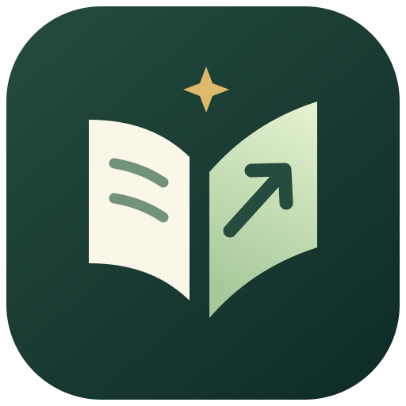

# 知跃 · Zhiyue 1.0

知有所向，思有跃迁。

由 **gulinyue** 开发的社区免费桌面助手，支持笔试截图出答案、文字问答、文字模拟面试、本机知识库与会话记录。无需应用账号，直接连接自己的模型服务。



## 安装

Windows 10 2004 或更新版本 / Windows 11，64 位系统。

从 [Releases](https://github.com/Gulinyue/zhiyue/releases) 下载 `Zhiyue-Setup-1.0.0-x64.exe`，双击后按中文向导选择安装位置。安装程序为当前用户安装，创建桌面与开始菜单快捷方式，无需另装 Node.js。安装包尚未购买代码签名证书，Windows 可能显示未知发布者。

首次运行需要配置自己的模型连接。发行版使用系统用户数据目录保存设置，不预置开发者的账号、密钥、资料或会话。卸载默认保留用户数据。

## 笔试模式

1. 在“连接与设置”配置截图模型，并在“笔试定制”选择知识库、编程语言、回答语言和提示词；顶部“快捷键提示栏”区域可直接选择“显示提示栏”或“隐藏提示栏”，默认显示。
2. 点击“笔试模式”或“开始笔试”，立即打开默认 52% 不透明度、鼠标穿透且不可点击的悬浮窗。
3. 打开题目，按 **Ctrl+Q** 截图，自动识题并生成答案，无需另点发送；长题按 **Ctrl+Shift+Q**。
4. 按 **Ctrl+Shift+Z** 退出笔试，恢复可点击的设置界面。退出会停止模型生成并丢弃迟到截图。

支持选择题、简答题、编程题；先给答案，再给必要解析，编程题包含代码和复杂度。新截图独立解题，文字追问继续当前上下文；模糊题干会要求补充。答案和笔试模式会保存在本机，可从会话记录继续。按键可在设置中修改。

## 模型连接

预设覆盖 OpenAI、Claude、Gemini、Azure、Grok、DeepSeek、Mistral、Groq、OpenRouter、通义千问、硅基流动、Kimi、GLM、Together、Fireworks、Perplexity，以及本机 Ollama / LM Studio。支持自定义 Base URL、模型 ID、模型列表发现和四种推理协议。

可通过 **Continue with ChatGPT** 在浏览器中授权自己的账号，使用符合账号权限的 ChatGPT 套餐模型。ChatGPT 授权是面向个人本地使用的预览集成；闭源社区版本公开分发前需另行确认产品的接入资格。应用本身免费，外部模型服务可能收费，额度和权限以服务商为准。使用本机模型需要自行运行对应服务。

## 悬浮窗与快捷键

普通“专注窗口”支持置顶、1%–100% 不透明度、拖动缩放和鼠标穿透。笔试模式自动进入不可点击浮层，使用独立的 15%–85% 不透明度设置。Windows 主窗口与快捷键提示浮层均启用并读回验证 WDA_EXCLUDEFROMCAPTURE；退出快捷键未注册或捕获排除不可用时，不进入笔试模式。

| 操作 | 默认快捷键 |
| --- | --- |
| 截图并直接出答案 | Ctrl+Q（笔试模式 / 专注窗口） |
| 滚动截图并直接出答案 | Ctrl+Shift+Q |
| 移动窗口 | Ctrl+Shift+方向键 |
| 上下滚动回答 | Ctrl+Win+↑ / ↓ |
| 横向滚动代码 / 表格 | Ctrl+Alt+Shift+← / → |
| 隐藏 | Ctrl+Shift+H |
| 显示窗口（笔试中保持穿透） | Ctrl+Shift+E |
| 退出笔试并恢复操作 | Ctrl+Shift+Z |
| 调整不透明度 | Ctrl+Shift+[ / ] |
| 普通专注窗口穿透切换（笔试中锁定） | Ctrl+Shift+X |

## 本地运行与构建安装包

需要 Node.js 22 或更新版本。已安装依赖时运行：

```powershell
npm.cmd start
npm.cmd run dist:win
```

新环境先执行 `npm.cmd ci`。安装包输出到 `dist/`，通过 electron-builder / NSIS 生成。开发数据保存在 `.runtime/local-dev/`。密钥及账号令牌使用操作系统安全存储加密，资料与文字会话保存在本机；原始截图不写入会话 JSON，可选择单独归档。渲染进程禁用网络连接，模型请求通过受限 IPC 在主进程中发送。打包只收录编译产物、运行依赖和许可文件，不收录开发数据及源码映射。

## 验证

```powershell
npm.cmd run verify          # 源码检查、46 项测试、构建
npm.cmd run test:smoke      # 实际 Electron：笔试截图直答、窗口与模型链路
npm.cmd run test:auth-smoke # 实际 Electron：模拟 OAuth、签名校验、加密存储
npm.cmd run assets:logo     # 从矢量母版重建 PNG / ICO
```

模型服务、OAuth 服务和截图图像在冒烟测试中使用模拟数据；不访问真实账号或付费模型。截图调度、多显示器选择、取消与超时另有测试。Windows 原生样式和显示亲和性通过实际 User32 读取验证；未对每一种会议软件进行录屏验收。捕获排除只覆盖支持该机制的系统路径，不保证阻止所有录制方式。真实模型的识题质量取决于所选模型和截图清晰度。语音识别与手机远控尚未接入。

## 许可与开发者标识

**社区免费使用，暂不开源授权。** 具体使用范围见 [LICENSE](LICENSE)。开发者为 **gulinyue**，署名位于界面关于区域、源码品牌配置、Logo 元数据和构建产物文件头，详见 [DEVELOPER.md](DEVELOPER.md)。第三方依赖许可保留。

[模型与窗口说明](docs/MODELS-WINDOW.md) · [本机架构与存储](docs/LOCAL.md)
